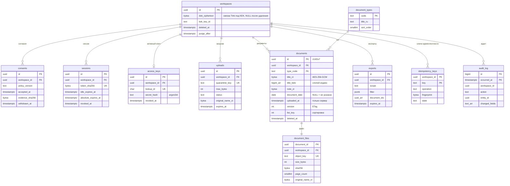

# 07. База данных (RFC-002)

Статус: принято. Схема: `07-data-model.sql` (проверена на PostgreSQL 18.6 и 17.8) и миграция `0002` поверх неё: функции записи (ADR-044), идемпотентность (ADR-045), связка ключей в `dek_ciphertext` (ADR-047). Нагрузочные данные: `db/seed-load.sql`. Планы запросов: `db/explain-queries.sql` и фактический вывод `db/explain-analyze.txt`. Источники обозначены S-номерами из `02-research-sources.md`.

## 1. Требования, из которых выведена схема

| # | Требование | Откуда | Решение в схеме |
|---|---|---|---|
| D1 | Медицинские документы = специальная категория ПДн | 152-ФЗ ст. 10 ч. 1 (S41) | Шифрование полей и файлов, RLS, аудит, согласие в отдельной таблице |
| D2 | Обработка только при письменном согласии субъекта | 152-ФЗ ст. 10 ч. 2 п. 1 (S41) | Таблица `consents`, без активного согласия запись документов запрещена на уровне API |
| D3 | БД с данными граждан РФ находится в РФ | 152-ФЗ ст. 18 ч. 5 (S42) | Только Yandex Managed PostgreSQL и Object Storage в регионе ru-central1; реплик за рубежом нет |
| D4 | Уровень защищённости ИСПДн | ПП РФ № 1119 п. 10 е, п. 11 в (S43) | Спецкатегории, угрозы 3-го типа: до 100 000 субъектов УЗ-3, свыше УЗ-2. Проектируем сразу под УЗ-2 |
| D5 | Чужой документ недоступен даже при ошибке в коде | OWASP API1:2023 BOLA (S27) | RLS с `FORCE`, политика по `workspace_id`, составные FK |
| D6 | Удалённый документ не возвращается | Задание R6 | Мягкое удаление + RESTRICTIVE-политика + физическое удаление и уничтожение ключа файла за 24 часа |
| D7 | Список и фильтры быстрые на любом объёме | NFR p95 < 300 мс (RFC-001) | Частичные индексы под каждый запрос, keyset-пагинация (S21, S39), бюджет БД p95 < 10 мс |

## 2. ERD

Нормализация: 3НФ. Справочник типов вынесен в таблицу (новый тип = `INSERT`, а не `ALTER TYPE`). Файл вынесен в `document_files` (1:1), потому что у документа и файла разные жизненные циклы: файл проверяется до создания документа, удаляется асинхронно. Денормализация одна и осознанная: `workspace_id` в `document_files` дублируется ради составного FK `(workspace_id, document_id)`, который делает невозможной ссылку файла на документ другого пространства (D5).

## 3. Ограничения целостности

| Таблица | Ограничение | Что ловит |
|---|---|---|
| documents | `documents_date_not_future`: `document_date <= uploaded_at::date + 1` | Дату из будущего (запас 1 день на часовые пояса) |
| documents | `document_date >= 1900-01-01` | Опечатку «0202» вместо «2020» |
| documents | `octet_length(title_ct) BETWEEN 29 AND 1024` | Пустое название (шифртекст GCM = 12 nonce + 16 tag + данные) |
| documents | `cardinality(title_bidx) BETWEEN 1 AND 256` | Документ, который не найдётся поиском |
| documents | триггер `bump_version`: `uploaded_at` неизменяема | Требование «дата загрузки фиксируется отдельно» нельзя нарушить даже SQL-запросом |
| document_files | `size_bytes BETWEEN 1 AND 20971520`, `content_type = 'application/pdf'`, `octet_length(sha256) = 32` | Файл вне лимита или не PDF |
| document_files | составной FK `(workspace_id, document_id)` → `documents(workspace_id, id)` | Связь между пространствами |
| uploads | `(status = 'rejected') = (reject_code IS NOT NULL)` | Отказ без причины |
| sessions | `idle_expires_at <= absolute_expires_at` | Сессию, которая живёт дольше абсолютного срока |
| access_keys | частичный UNIQUE `(workspace_id) WHERE revoked_at IS NULL` | Два активных ключа |
| consents | частичный UNIQUE `(workspace_id) WHERE withdrawn_at IS NULL` | Два активных согласия |
| idempotency_keys | PK `(workspace_id, key)` | Ключ одного клиента не находит запись другого (S19, раздел 5: составной ключ поиска) |
| workspaces | `(deleted_at IS NULL) = (purge_after IS NULL)` | Удалённое пространство без срока уничтожения |
| workspaces | `workspaces_dek_kept_until_deleted`: `dek_ciphertext IS NOT NULL OR deleted_at IS NOT NULL` (0002) | Стёртый ключ у живого архива |
| idempotency_keys | CHECK операций, `response_body_ct` только при `state = 'completed'` (0002) | Неизвестную операцию и тело незавершённой попытки |

Все проверки дублируются в API (pydantic) ради понятного текста ошибки, но источник истины база: ошибка в коде не запишет мусор.

## 4. Индексы и фактические планы

Стенд: PostgreSQL 18.6, 2001 пространство, 210 000 документов (одно «тяжёлое» пространство на 10 000, остальные по 100), 3% удалены, после `VACUUM ANALYZE`. Все запросы выполнены ролью `ma_app` под RLS. Полный вывод в `db/explain-analyze.txt`.

| Запрос | Индекс | План | Время |
|---|---|---|---|
| Q1 Первая страница, 51 строка, 10 000 документов | `documents_list (workspace_id, list_key, uploaded_at, id) INCLUDE (type_code, document_date) WHERE deleted_at IS NULL` | Index Scan, без сортировки | 0,117 мс |
| Q2 Следующая страница по курсору | тот же | Index Scan, `ROW(list_key, uploaded_at, id) > ROW(...)` в Index Cond | 0,088 мс |
| Q3 Период по дате документа + `matched` + `undated_excluded` | тот же | Index Only Scan, счётчики одним проходом через `count(*) FILTER` | 2,40 мс |
| Q4 Поиск «анализ» (15% документов совпадают) | `documents_title_bidx USING gin (workspace_id, title_bidx)` (btree_gin) | Bitmap Index Scan по `workspace_id`, `title_bidx @>` в Filter, top-N heapsort | 5,84 мс (18.6, эталон), 7,36 мс (18, сид тестов `tests/db`), 2,7 мс (17.8) |
| Q5 Период по дате загрузки в Europe/Moscow | `documents_by_upload (workspace_id, uploaded_at, id)` | Index Scan, границы суток в Index Cond | 0,072 мс |
| Q6 Только без даты | `documents_list` (`list_key = 2147483647`) | Index Only Scan | 0,033 мс |
| Q7 Обычное пространство, 100 документов | `documents_list` | Index Scan | 0,059 мс |

Решения, которые дали эти цифры:
1. **`list_key` вместо `ORDER BY document_date DESC NULLS LAST, uploaded_at ASC`.** Смешанные направления сортировки не позволяют сравнивать кортеж курсора одним условием: первый вариант схемы давал `Filter` и `Rows Removed by Filter: 2496` на второй странице (2,07 мс). Генерируемая колонка `list_key = 1900-01-01 - document_date` (без даты = `INT_MAX`) переводит всю сортировку в ASC, и курсор становится `Index Cond` (0,088 мс, в 23 раза быстрее). Это и есть keyset-пагинация (S39): стоимость страницы не растёт с её номером, в отличие от `OFFSET`.
2. **Частичные индексы `WHERE deleted_at IS NULL`** (S34): удалённые строки не занимают место в индексах списка и не попадают в планы.
3. **Фильтр по дате загрузки** переводится в полуинтервал `[from 00:00 МСК, to + 1 день 00:00 МСК)` на стороне SQL через `AT TIME ZONE`. Колонка `timestamptz` не оборачивается функцией, поэтому индекс работает (Q5).
4. **`INCLUDE (type_code, document_date)`** даёт Index Only Scan для счётчиков и списка без даты.
5. **GIN по `(workspace_id, title_bidx)`** через `btree_gin`: индекс сразу ограничен пространством. Под `ma_app` условие `title_bidx @> ...` остаётся в `Filter`, а не в Index Cond: функция `arraycontains` не помечена `LEAKPROOF`, и при FORCE RLS планировщик не переносит её в индекс раньше условий политики (под суперпользователем без RLS тот же запрос даёт `@>` в Index Cond; явные классы операторов план не меняют; ADR-046). Время укладывается в бюджет, совпадения точные, ложных срабатываний 0 из 1457.

Бюджет: запрос к БД p95 ≤ 10 мс на пространство до 10 000 документов; Q4 ближе всех к нему (7,36 мс). CI прогоняет запросы Q1..Q7 на сид-данных под `ma_app` (`EXPLAIN (ANALYZE, FORMAT JSON)`, S37) и падает, если в плане есть узел вне списка допустимых для запроса или время больше 10 мс. Допустимые узлы: Q1, Q2, Q7 Index Scan по `documents_list`; Q3, Q6 Index Only Scan по `documents_list`; Q4 Bitmap Index Scan по `documents_title_bidx`, Bitmap Heap Scan и Sort (top-N); Q5 Index Scan по `documents_by_upload` или Bitmap Index Scan по `documents_by_upload`, Bitmap Heap Scan и Sort. Во всех запросах разрешены Limit, Result, Aggregate; `Seq Scan` по `documents` запрещён везде. Q5 выбирает между Index Scan и Bitmap Heap Scan + Sort по физическому порядку строк (корреляции `workspace_id`): на перемешанных данных реального архива второй вариант законен, оба укладываются в бюджет (0,13 мс и около 0,6 мс).

## 5. Поиск по зашифрованному названию: слепой индекс триграмм

Проблема: название документа («Заключение онколога») само по себе медицинская информация, его нужно шифровать. Но `pg_trgm` (S33) работает только с открытым текстом, а функции `pgcrypto` выполняются внутри сервера, и данные с ключами идут между приложением и БД в открытом виде (S35, раздел «Security Limitations»). Значит, шифровать в БД через `pgcrypto` нельзя: ключ окажется в логах запросов и в `pg_stat_statements`.

Решение:
1. Приложение нормализует название (`lower`, затем `ё → е`, схлопывание пробелов) и режет на триграммы по правилам `pg_trgm`: слово (буквы и цифры) дополняется двумя пробелами слева и одним справа. Триграммы считает приложение по тексту; `show_trgm` в БД не используется: для кириллицы он возвращает сжатые коды вида `0x9e3680`.
2. Каждая триграмма превращается в `HMAC-SHA256(ключ_индекса_пространства, триграмма в UTF-8)`, первые 8 байт читаются как знаковое big-endian `bigint`. Массив без повторов пишется в `title_bidx`.
3. Запрос нормализуется так же, но граничные пробелы не добавляются на краях запроса: у первого слова нет левого дополнения, у последнего нет правого (ADR-046). Поэтому «анали» даёт `ана`, `нал`, `али` и находит «анализ», а с граничными пробелами нашлись бы только целые слова. Затем HMAC и `title_bidx @> ARRAY[...]`. Совпадения по всем триграммам дают кандидатов; приложение расшифровывает названия кандидатов и проверяет подстроку: это защищает и от коллизий 64-битного HMAC (около 2^-64 на пару), и от документов, где триграммы запроса есть в разных словах («ана нал али» на запрос «анали»).
4. Запрос из 1 или 2 непробельных символов отклоняется (422), из одних пробелов означает «без поиска».
5. Ключ слепого индекса свой у каждого пространства, поэтому одинаковые названия в разных архивах дают разные хэши: нельзя сопоставить архивы между собой.

Что раскрывается: число триграмм и частота повторов внутри одного архива. Это осознанный компромисс; альтернатива (расшифровывать все названия архива на каждый запрос) работает до примерно 2000 документов и ломает пагинацию на стороне БД.

## 6. Шифрование

| Данные | Где | Как | Ключ |
|---|---|---|---|
| `title_ct`, `note_ct`, `original_name_ct` | PostgreSQL | AES-256-GCM (Tink AEAD, префикс вывода RAW), AAD = `document_id` (шифртекст нельзя переставить в другую строку) | DEK пространства |
| PDF-файлы | Object Storage | Tink Streaming AEAD AES256_GCM_HKDF_4KB, AAD = `document_id` | DEK пространства |
| Связка ключей пространства: AEAD полей, Streaming AEAD файлов, PRF слепого индекса | `workspaces.dek_ciphertext`, 390 байт (ADR-047) | Конвертное шифрование: связка зашифрована KEK (S44) | Прототип: KEK в файле Tink, смонтированном только для чтения (ADR-041); онлайн: KEK в Yandex KMS, ротация раз в год |
| Диски БД, бакет, бэкапы | Yandex Cloud | Шифрование на стороне сервиса | Управляемые ключи |

Почему конверт, а не KMS на каждое поле: у прямого `encrypt` в Yandex KMS лимит 32 КБ и сетевой вызов на каждую операцию (S44). DEK расшифровывается один раз на запрос, держится в памяти процесса не дольше запроса и не пишется на диск (S44: «Открытый DEK должен расшифровываться только на время шифрования или расшифрования данных»).

**Крипто-удаление.** Удаление пространства = `dek_ciphertext = NULL` в той же транзакции, что и `deleted_at` (ADR-041). Все копии полей и файлов, включая лежащие в бэкапах до истечения их срока, становятся нечитаемыми сразу, а не через 30 дней. Ограничение прототипа: копия тома PostgreSQL, снятая до удаления, вместе с файлом KEK расшифровывается.

## 7. Row-Level Security

1. Роли: `ma_owner` (владелец схемы, только миграции), `ma_app` (API, `NOBYPASSRLS`), `ma_worker` (фоновые задачи, `NOBYPASSRLS`), `ma_auth` (`NOLOGIN BYPASSRLS`, владеет функциями входа и записи миграций 0001 и 0002, ADR-044).
2. На всех таблицах с данными `ENABLE` и `FORCE ROW LEVEL SECURITY`. Без политики действует запрет по умолчанию (S32: «If no policy exists for the table, a default-deny policy is used»), `FORCE` распространяет политики и на владельца.
3. Контекст: в начале каждой транзакции API выполняет `SELECT set_config('app.workspace_id', $1, true)` (третий аргумент `true` = до конца транзакции). Это безопасно с PgBouncer в режиме transaction pooling: значение не переживает транзакцию и не утечёт следующему клиенту соединения.
4. Политика `ws_isolation`: `workspace_id = app.current_workspace()` для чтения и `WITH CHECK` для записи.
5. Политика `hide_deleted` (RESTRICTIVE, SELECT): удалённые документы невидимы приложению даже по прямому условию.
6. Код всё равно передаёт `workspace_id = $1` явно: это даёт планировщику точную селективность (в планах видно `Index Cond` по литералу), а RLS остаётся второй линией защиты.
7. Таблицы `sessions` и `access_keys` приложению недоступны вовсе. Вход идёт только через `app.resolve_session(token_sha256)` и `app.find_access_key(lookup_id)`, запись в `workspaces`, `sessions`, `access_keys`, `purge_queue` и выборка воркера только через функции миграции 0002 (`SECURITY DEFINER`, владелец `ma_auth`, `search_path = pg_catalog, pg_temp`, ADR-044).

Проверено на стенде (вывод в `db/explain-analyze.txt`, Q8 до Q11): чужое пространство при чужом контексте 0 строк; без контекста 0 строк; удалённые 0 строк; вставка в чужое пространство: `ERROR: new row violates row-level security policy`.

## 8. Мягкое удаление, сроки хранения, уничтожение

| Объект | Событие | Что происходит | Срок |
|---|---|---|---|
| Документ | `DELETE /v1/documents/{id}` | `deleted_at = now()`, строка невидима (RLS), объект файла ставится в `purge_queue` | Сразу |
| Документ | Задача `purge_documents` | Физический `DELETE` строки и файла, запись `document.purge` в аудит | ≤ 24 часа |
| Пространство | `DELETE /v1/workspace` или отзыв согласия | `deleted_at`, `purge_after = now() + 24 h`, все сессии отзываются; DEK удаляется | ≤ 24 часа |
| Загрузка | Не подтверждена документом | Строка `uploads` истекает (потом 410 `upload_expired`); объект в карантинном бакете удаляется правилом жизненного цикла | Строка 1 час, объект 1 сутки |
| Ключ идемпотентности | | Удаление | 24 часа |
| Экспорт | | Ссылка недействительна | 1 час |
| Сессия | Нет активности | Недействительна | 30 дней простоя, 180 дней абсолютный срок (S28: idle и absolute timeout; ADR-047) |
| Журнал аудита | | Удаление секции целиком (`DROP TABLE audit_log_YYYY_MM`) | 12 месяцев |
| Бэкапы БД | | Автоматическая ротация | 7 дней PITR (по умолчанию в сервисе, S46) |

Основание сроков: 152-ФЗ, ст. 5 ч. 7: хранение ПДн «не дольше, чем этого требуют цели обработки» (S48). Сроки выбраны как минимально достаточные для работы сервиса. Мягкое удаление нужно не для «корзины», а для атомарности: строка исчезает из выдачи в той же транзакции, где проверены права, а медленное удаление файла не держит транзакцию.

## 9. Журнал аудита
1. Append-only: `UPDATE` и `DELETE` не выданы ни одной роли приложения.
2. Без содержимого: только действие, id сущности, **имена** изменённых полей, `request_id`, префикс IP (/24 для IPv4, /48 для IPv6).
3. Пишется триггером `audit_documents` в той же транзакции, что и изменение: не бывает изменения без записи.
4. Секционирование по месяцам (`PARTITION BY RANGE (occurred_at)`), задача `pg_partman` или cron создаёт секцию на 2 месяца вперёд; секция `DEFAULT` ловит всё остальное и мониторится (не должна расти).

## 10. Миграции

1. Alembic, по одной ревизии на изменение, только вперёд; `downgrade` пишется, но в проде не выполняется: откат = новая миграция.
2. Схема «расширить, затем сузить» (expand/contract): новая колонка добавляется nullable, код пишет в обе, бэкфилл батчами по 1000 строк, затем `NOT NULL` через `ADD CONSTRAINT ... NOT VALID` и `VALIDATE CONSTRAINT` (не блокирует запись).
3. Индексы в проде только `CREATE INDEX CONCURRENTLY` (отдельная миграция без транзакции).
4. `lock_timeout = '3s'` и `statement_timeout = '60s'` в каждой миграции: миграция падает, а не вешает прод.
5. CI: `alembic upgrade head` на пустой базе, затем на копии сид-данных, затем `EXPLAIN`-проверка из раздела 4.

## 11. Резервное копирование и восстановление
1. Yandex Managed PostgreSQL: PITR включён по умолчанию, восстановление на любой момент после самой старой полной копии, только в новый кластер; срок хранения автоматических копий 7 дней по умолчанию, настраивается 7 до 60 (S46). Механизм тот же, что в PostgreSQL: базовая копия + архив WAL (S36).
2. RPO ≤ 5 минут (архивирование WAL), RTO ≤ 1 час (восстановление в новый кластер + переключение DNS-имени).
3. Учение раз в месяц: восстановление в новый кластер на момент «вчера 12:00», прогон `SELECT count(*)` по таблицам и расшифровка 10 случайных документов. Без расшифровки учение не засчитывается: бэкап без ключей бесполезен.
4. Бакет `ma-docs`: версионирование выключено (ADR-047), чтобы удалённый файл не оставался читаемым; от ошибочного удаления защищает мягкое удаление строки в течение 24 часов до задачи purge.

## 12. Производительность приложения поверх БД
1. **N+1:** документы и файлы читаются одним `JOIN` (1:1); для коллекций `selectinload`, а в тестах `raiseload("*")`, чтобы ленивую загрузку было невозможно допустить незаметно (S40).
2. Пул соединений: `asyncpg` с пулом 10 на процесс + PgBouncer (transaction mode) перед кластером.
3. Подготовленные запросы: включены в asyncpg; с PgBouncer 1.21+ поддерживаются в transaction mode (`max_prepared_statements`).
4. Кэш: ПДн не кэшируются ни в Redis, ни в CDN. Кэшируется только справочник типов (в памяти процесса) и расшифрованный DEK в пределах запроса.
5. Счётчики `total`, `matched`, `undated_excluded` считаются одним запросом (Q3), не тремя.
