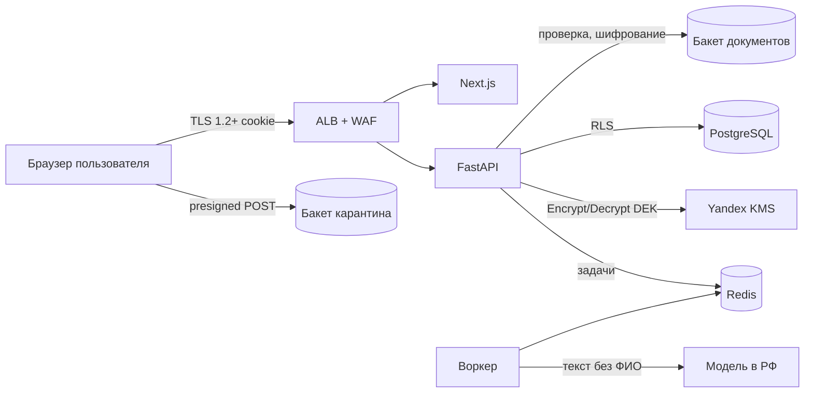

# 08. Безопасность и приватность (RFC-003)

Статус: принято, 10.11.2026. Метод: четыре вопроса моделирования угроз и STRIDE по потокам данных, LINDDUN для приватности (S55). Требования сопоставлены с OWASP ASVS 5.0 (S49) и OWASP API Security Top 10 2023 (S27). Правовая база: 152-ФЗ (S41, S42, S48) и ПП РФ № 1119 (S43).

## 1. Что мы защищаем

| Актив | Ценность | Где лежит |
|---|---|---|
| PDF медицинских документов | Специальная категория ПДн (состояние здоровья), 152-ФЗ ст. 10 | Object Storage `ma-docs`, шифртекст Tink Streaming AEAD |
| Название, заметка, исходное имя файла | Раскрывают диагноз и обращения | PostgreSQL, AES-256-GCM |
| Дата документа, тип, размер | Метаданные, косвенно о здоровье | PostgreSQL, открыто (нужно для сортировки), под RLS |
| Сессия и ключ доступа | Полный доступ к архиву | Cookie браузера; в БД хэш SHA-256 и Argon2id |
| DEK пространства | Расшифровка всего архива | БД только обёрнутым KEK; KEK в Yandex KMS, в прототипе в файле Tink (ADR-041) |
| Журнал аудита | Подотчётность | `audit_log`, без значений полей |

## 2. Границы доверия и потоки

Границы: (1) интернет / ALB, (2) приложение / данные, (3) приложение / KMS, (4) воркер / внешняя модель. Все компоненты в ru-central1.

## 3. STRIDE

| # | Угроза | Категория | Поток | Ответ | Мера | ASVS 5.0 | API Top 10 |
|---|---|---|---|---|---|---|---|
| T1 | Кража cookie сессии через XSS | S | Браузер | Mitigate | HttpOnly, CSP `default-src 'self'`, React экранирует вывод, без `dangerouslySetInnerHTML` | V3, V7 | API2 |
| T2 | Перебор ключа доступа | S | `POST /sessions` | Mitigate | 90 бит секрета, Argon2id, 5 попыток за 15 мин на IP, одинаковое время ответа | V6 | API2, API4 |
| T3 | Чтение чужого документа подстановкой id | I | API | Mitigate | UUIDv7, `workspace_id` из сессии, FORCE RLS, ответ 404 | V8 | API1 |
| T4 | Изменение чужих полей (`workspace_id`, `version`) в теле | T | `PATCH` | Mitigate | Схемы с `additionalProperties: false`, сервер задаёт эти поля сам | V2, V8 | API3 |
| T5 | Загрузка вредоносного файла как PDF | T | Загрузка | Mitigate | Карантинный бакет, проверка `%PDF-` и pypdf, `Content-Type` фиксирован, отдача с `CSP: sandbox` и `nosniff`, имя файла только как метаданные | V5 | API8 |
| T6 | Подмена шифртекста между документами | T | БД | Mitigate | AAD = `document_id` в AES-GCM и Streaming AEAD | V11 | |
| T7 | Утечка дампа или бэкапа БД | I | Данные | Mitigate | Envelope-шифрование, KEK вне БД; бэкап без KMS бесполезен | V11, V14 | |
| T8 | ПДн в логах и ошибках | I | Логи | Eliminate | Логируем `request_id`, маршрут, код, длительность; ошибки без значений и стека | V16 | API8 |
| T9 | Отправка медицинского текста во внешнюю модель | I | Воркер / LLM | Mitigate | Флаг выключен по умолчанию, модель с хостингом в РФ, маскирование ФИО и даты рождения, только первые 4000 символов | V14 | API10 |
| T10 | Инъекция в подсказку модели через текст PDF | T | LLM | Mitigate | Ответ только JSON по схеме, значения подставляются в поля как текст, человек подтверждает | V2 | API10 |
| T11 | Отказ в обслуживании загрузками и экспортом | D | API | Mitigate | Лимиты, 20 МБ в политике presigned, очередь AI 20, `statement_timeout` 5 с | V13 | API4, API6 |
| T12 | Отрицание удаления или изменения | R | API | Mitigate | `audit_log` только на добавление | V16 | |
| T13 | Повышение привилегий через функцию с обходом RLS | E | БД | Mitigate | Только функции `ma_auth` из миграций 0001 и 0002 с узкими аргументами, архив из `app.current_workspace()`, `search_path = pg_catalog, pg_temp` (ADR-044), `ma_app` без DDL | V8, V13 | API5 |
| T14 | CSRF на изменяющих запросах | T | Браузер | Mitigate | `SameSite=Lax` + `X-CSRF-Token` | V3, V7 | |
| T15 | Компрометация зависимостей | T | CI | Mitigate | Lock-файлы, Dependabot, pip-audit, npm audit, Trivy, gitleaks | V15 | API9 |
| T16 | Общий компьютер: следующий человек видит архив | I | Браузер | Mitigate | `no-store`, кнопка «Выйти на этом устройстве», простой 30 дней | V7, V14 | |

Остаточный риск, принятый осознанно: слепой индекс раскрывает частоты триграмм внутри одного пространства тому, кто уже получил доступ к БД (Accept, обоснование в 07-database, раздел 5); метаданные `document_date` и `type_code` хранятся открыто ради сортировки и фильтра (Accept: без названия и файла они не раскрывают диагноз).

## 4. Приватность (LINDDUN, кратко)

| Угроза | Мера |
|---|---|
| Связывание (Linking) | Нет email и телефона; пространство не связано с личностью |
| Идентификация | Модель получает текст без ФИО и даты рождения |
| Неосведомлённость (Unawareness) | Экран согласия до первой загрузки, политика по ссылке, версия согласия в журнале |
| Невозможность вмешаться | Экспорт всего архива и удаление архива в два шага, без обращения в поддержку |
| Несоответствие требованиям | Раздел 6 |

## 5. Криптография

| Что | Алгоритм | Ключ | Ротация |
|---|---|---|---|
| Поля в БД | AES-256-GCM (Tink AEAD), AAD = `document_id` | DEK пространства | Новый DEK при перешифровании по запросу, старый храним до завершения |
| Файлы | Tink Streaming AEAD AES256_GCM_HKDF_4KB, AAD = `document_id` (S52, ADR-047) | DEK пространства | Как выше |
| DEK | Envelope (S44): связка ключей пространства под KEK | Прототип: KEK AES-256 в файле Tink (ADR-041); онлайн: KEK в Yandex KMS | Ротация KEK раз в год, старые версии для расшифровки |
| Слепой индекс | HMAC-SHA256, усечение до 64 бит | Ключ индекса пространства, обёрнут KEK | При перешифровании |
| Курсоры страниц | AES-GCM | Ключ приложения в Lockbox | Раз в 90 дней, два активных |
| Ключ доступа | Argon2id m=19 MiB, t=2, p=1 (S51) | | При «выпустить новый ключ» |
| Сессия | 256 бит CSPRNG, в БД SHA-256 | | При входе по ключу |
| Транспорт | TLS 1.2+ на ALB, HSTS | Certificate Manager | Автоматически |

## 6. 152-ФЗ и ПП № 1119

| Требование | Норма | Как выполняем |
|---|---|---|
| Сведения о здоровье это специальная категория; обработка допускается с согласия в письменной форме | 152-ФЗ ст. 10 (S41) | Экран согласия до создания архива; запись `consents` с версией политики и временем; без согласия API отвечает 403 `consent_required`. Для боевого запуска юрист выбирает форму согласия, отвечающую требованию письменной формы (электронная с подтверждением) |
| Локализация: запись, накопление, хранение ПДн граждан РФ в БД на территории РФ | ст. 18 ч. 5 (S42) | Все хранилища, логи и бэкапы в Yandex Cloud ru-central1 |
| Хранение не дольше цели обработки, уничтожение по достижении цели или отзыву согласия | ст. 5 ч. 7 (S48) | Удаление архива = отзыв согласия: сессии отозваны сразу, DEK удалён, физическая очистка за 24 ч; брошенные загрузки удаляются через 1 день |
| Уведомление уполномоченного органа до начала обработки | ст. 22 ч. 1, 3, 3.1 (S57) | Подаётся до запуска с реальными пользователями; в уведомлении: цель, специальная категория (здоровье), меры защиты и шифровальные средства (Tink AEAD, Yandex KMS), трансграничной передачи нет, БД в ru-central1. Ответственный: владелец продукта (OPS-11) |
| Уровень защищённости | ПП № 1119 п. 10, 11 (S43) | Специальная категория при угрозах 3 типа: УЗ-3 до 100 тыс. субъектов, УЗ-2 свыше. Проектируем под УЗ-2: шифрование, разграничение доступа, журнал, резервирование |

## 7. Сопоставление с OWASP ASVS 5.0

| Глава | Что проверяем у нас |
|---|---|
| V1 Encoding and Sanitization | Параметризованный SQL (SQLAlchemy), экранирование React, имена файлов в `Content-Disposition` через `filename*` |
| V2 Validation and Business Logic | Pydantic-схемы, даты не в будущем, длины полей, порядок шагов загрузки |
| V3 Web Frontend Security | CSP, `frame-ancestors 'none'`, `nosniff`, CSRF-токен |
| V4 API and Web Service | `problem+json`, методы HTTP по смыслу, лимиты, CORS только свой origin |
| V5 File Handling | Карантин, сигнатура, размер в политике, отдача с `sandbox` |
| V6 Authentication | Ключ доступа Argon2id, лимит попыток, одинаковое время ответа |
| V7 Session Management | `__Host-` cookie, ротация, простой и абсолютный срок, выход |
| V8 Authorization | RLS, скоупы, 404 на чужое |
| V9 Self-contained Tokens | JWT не используется в браузере; для будущих клиентов белый список `alg`, `aud`, `exp` (S30) |
| V11 Cryptography | Tink, KMS, AAD, ротация |
| V12 Secure Communication | TLS 1.2+, HSTS |
| V13 Configuration | Секреты в Lockbox, образы не root, роли БД с минимумом прав |
| V14 Data Protection | `no-store`, шифрование, минимизация данных в списке (`has_note` вместо заметки) |
| V15 Secure Coding and Architecture | Зависимости под аудитом, модульный монолит с явными границами |
| V16 Security Logging | Аудит действий без значений, `request_id` |
| V17 WebRTC | Не применимо |

Глава V10 (OAuth и OIDC) применяется только к будущим нативным клиентам.

## 8. Проверка

Тесты TC-090 до TC-098 и TC-104 из `05_qa/test-cases.md` автоматизированы в CI; модель угроз пересматривается при каждом новом внешнем потоке данных (например, при появлении вебхуков или ссылки «показать врачу»).
