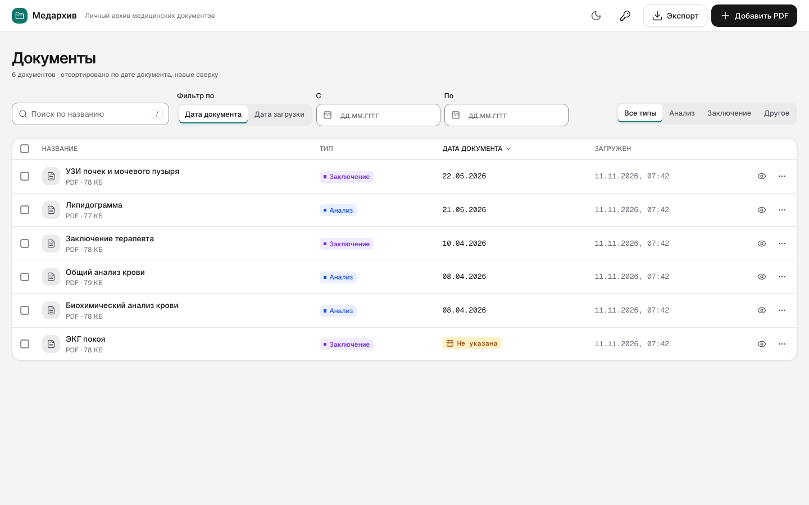
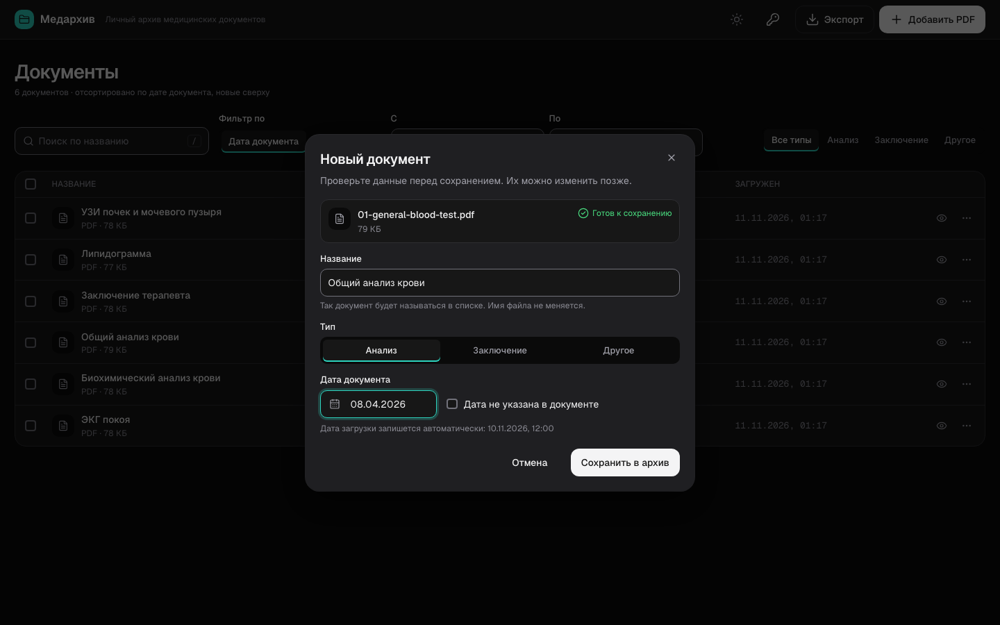
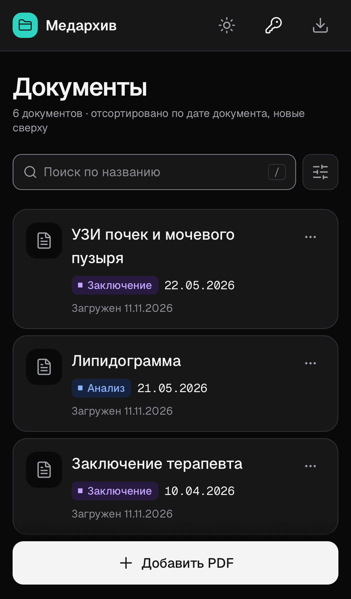
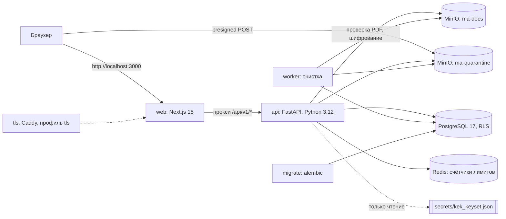

# Медархив

Личный архив медицинских PDF: анализы, заключения врачей, выписки. Человек загружает документ, подписывает его (название, тип, дата документа), потом находит по названию, фильтрует по датам, пишет заметки и выгружает архив в ZIP. Регистрации нет: доступ к архиву даёт ключ из 24 символов.

Это прототип. Он запускается локально через `docker compose`, облачного стенда нет. Текст политики обработки персональных данных и часть подписей интерфейса написаны для прототипа и юристом не проверены (в `docs/texts.md` у таких строк статус «новый текст, требует утверждения владельцем»).

| Список документов, десктоп, светлая тема | Новый документ, десктоп, тёмная тема | Телефон, тёмная тема |
|---|---|---|
|  |  |  |

Снимки всех экранов в двух темах, десктоп 1440 x 900 и iPhone 13: `e2e/artifacts/screens/`.

## Что умеет

- Загрузка PDF до 20 МБ: перетаскиванием или выбором файла. Не-PDF, слишком большой, повреждённый и защищённый паролем файл отклоняются с понятной причиной.
- Название, тип (анализ, заключение, другое) и дата документа. Дату можно не указывать: такой документ помечен «Не указана», стоит в конце списка и не теряется в фильтре. Дата подставляется из имени файла или свойств PDF, человек её проверяет. Дата загрузки ставится автоматически.
- Поиск по подстроке в названии (от 3 символов), фильтр по дате документа или дате загрузки и по типу, применённые фильтры видны чипами.
- Просмотр PDF, заметка к документу с автосохранением, правка, удаление.
- Экспорт в ZIP: весь архив, найденные или отмеченные документы. Внутри PDF с понятными именами, `documents.csv` и `documents.json`.
- Ключ доступа вместо аккаунта: показывается один раз, его можно скопировать или скачать файлом. По ключу архив открывается в другом браузере или на другом устройстве. В настройках можно выпустить новый ключ, выйти на устройстве и удалить весь архив.
- Шифрование на стороне приложения: названия, заметки, имена файлов и сами PDF лежат в базе и хранилище только в зашифрованном виде.
- Светлая и тёмная тема, мобильная вёрстка, WCAG 2.2 AA (проверяется axe в E2E).

## Быстрый запуск

### Что нужно

| Что | Зачем | Проверено на |
|---|---|---|
| Docker Desktop (macOS, Windows) или Docker Engine с Compose v2 (Linux) | Весь стек работает в контейнерах | Docker 27.3.1, Compose 2.29.7, macOS |
| `git`, `make` | Клонирование и команды из `Makefile`. На macOS `make` ставится с Xcode Command Line Tools | |
| [uv](https://docs.astral.sh/uv/) | Только для `make secrets`: генератор ключей использует Tink из окружения API. uv сам скачает Python 3.12 и зависимости. Без uv см. «Запуск без uv» ниже | uv 0.9.17 |
| Память для Docker 4 ГБ, лучше 6 ГБ | Сумма лимитов `mem_limit` в `docker-compose.yml` около 3,9 ГБ, реальный пик под нагрузкой гейта около 1 ГБ, плюс сборка образа web | |
| Диск около 5 ГБ | Образы (api 320 МБ, web 225 МБ, postgres 290 МБ, MinIO, Redis), кэш сборки, тома с данными | |
| Свободные порты на `127.0.0.1`: 3000, 8000, 9000, 9001 | web, api, MinIO и его консоль. Другие порты задаются в `.env`: `WEB_PORT`, `API_PORT`, `MINIO_PORT`, `MINIO_CONSOLE_PORT` | |
| Интернет при первой сборке | Образы из Docker Hub и ghcr.io, пакеты из npm и PyPI | |

Node.js, pnpm и Playwright для запуска не нужны, только для разработки (см. «Как протестировать»).

### Шаги

```bash
git clone <адрес-репозитория> medarchive
cd medarchive
make up
```

`make up` делает две вещи:

1. `make secrets`: создаёт `.env` из `.env.example` (пустые значения заполняются случайными секретами) и ключ шифрования `secrets/kek_keyset.json`. Оба файла с правами 0600 и в `.gitignore`. Существующие файлы не перезаписываются.
2. `docker compose up -d --build --wait`: собирает образы api и web, поднимает PostgreSQL, MinIO, Redis, выполняет миграции и ждёт, пока все сервисы станут healthy. Первая сборка занимает несколько минут.

Проверка, что всё живо:

```bash
curl http://localhost:8000/readyz
# {"status":"ok","checks":{"db":"ok","storage":"ok","kek":"ok"}}
```

Откройте **http://localhost:3000** в Chrome, Firefox или Edge.

### Демо-данные

```bash
make seed
```

Создаёт новый архив с шестью тестовыми PDF из `MedArchive/05_qa/fixtures/` и печатает его id и ключ доступа (`access key: XXXX-XXXX-XXXX-XXXX-XXXX-XXXX`). Чтобы открыть этот архив: на стартовой странице «Уже есть архив? Открыть по ключу» (или `http://localhost:3000/restore`), вставьте ключ. Положить документы в существующий архив: `make seed WORKSPACE=<id>`.

### Safari и профиль `tls`

Сессия хранится в cookie `__Host-ma_sid` с флагом `Secure`. Chrome и Firefox считают `http://localhost` безопасным и cookie сохраняют, Safari нет: в нём архив не переживёт перезагрузку страницы. Для Safari (и для E2E на WebKit) есть профиль `tls` с Caddy перед web и хранилищем:

```bash
echo 'S3_PUBLIC_ENDPOINT=https://localhost:9443' >> .env
docker compose --profile tls up -d --build --wait
```

Сертификат выпускает локальный центр Caddy, браузер ему не доверяет. Откройте один раз https://localhost:9443 и примите предупреждение (иначе браузер молча заблокирует загрузку файла в хранилище), затем работайте на **https://localhost:3443**. Вернуться к обычному режиму: удалить строку `S3_PUBLIC_ENDPOINT` из `.env` и выполнить `docker compose --profile tls down`, затем `make up`.

### Остановить и сбросить

| Что | Команда |
|---|---|
| Остановить, данные сохранить | `make down` (с профилем tls: `docker compose --profile tls down`) |
| Удалить все архивы и файлы | `docker compose down -v` (тома `pg_data` и `minio_data`) |
| Полный сброс, включая секреты | `docker compose down -v && rm -rf .env secrets && make up` |

Не удаляйте `.env` или `secrets/kek_keyset.json`, оставляя тома: пароли ролей БД задаются при первом запуске, а новым ключом шифрования старые документы не расшифровать.

### Лимиты запросов при ручном тестировании

API ограничивает создание архивов (10 в час) и попытки входа по ключу (5 за 15 минут) на один адрес. Локально все запросы браузера идут через прокси web, поэтому все вкладки и браузеры тратят один общий бюджет. Если при активном тестировании появилось «слишком много попыток», добавьте в `.env` строку `RATE_LIMITS_ENABLED=false` и выполните `docker compose up -d`. Для проверки самих лимитов уберите её обратно.

### Запуск без uv

`make up` всегда вызывает `make secrets`, а он требует uv. Секреты можно сгенерировать тем же скриптом внутри образа api, а стек поднять напрямую через compose:

```bash
docker build -t medarchive/api:local apps/api
docker run --rm --user "$(id -u):$(id -g)" -v "$PWD:/repo" -w /repo \
  medarchive/api:local python infra/secrets/generate.py
docker compose up -d --build --wait
```

### Linux и Windows

Проект собирался и проверялся на macOS с Docker Desktop. На Linux и Windows его не запускали, известные риски:

- **Linux:** файл `secrets/kek_keyset.json` создаётся с правами 0600 от вашего пользователя, а api в контейнере работает от uid 10001 и может не прочитать его (Docker Desktop это скрывает). Признак: в `/readyz` проверка `kek` не `ok`, создание архива падает. Обход для локального стенда: `sudo chown 10001 secrets/kek_keyset.json`.
- **Windows:** работайте в WSL2 (Ubuntu) с включённой интеграцией Docker Desktop. Клонируйте репозиторий в файловую систему WSL (`~/…`), а не в `/mnt/c`: при клонировании из Windows с `core.autocrlf=true` shell-скрипты в `infra/` получат CRLF и контейнеры инициализации упадут.

## Как протестировать

### Ручной сценарий для тестировщика

1. Откройте http://localhost:3000 в чистом профиле. Кнопка выбора файла заблокирована, пока не отмечено согласие на обработку данных.
2. Отметьте согласие, выберите PDF (подойдут файлы из `MedArchive/05_qa/fixtures/`). Создаётся архив, открывается форма нового документа.
3. Проверьте название, тип и дату, сохраните. После первого документа показывается ключ доступа: скопируйте или скачайте его. Ключ показывается один раз.
4. Добавьте ещё несколько PDF, в том числе без даты (отметка «Дата не указана в документе») и неподходящие файлы: не PDF, больше 20 МБ, защищённый паролем. У неподходящих должна быть понятная причина отказа.
5. Поиск: введите часть названия (от 3 символов). Фильтр: период по дате документа, затем по дате загрузки, тип. Сбросьте фильтры.
6. Откройте документ: просмотр PDF, заметка (сохраняется сама), правка названия, типа и даты.
7. Удалите документ из списка и со страницы документа.
8. Экспорт: весь архив, только найденные, отмеченные. Распакуйте ZIP и проверьте имена файлов, `documents.csv` (открывается в Excel) и `documents.json`.
9. Откройте архив в другом браузере по ключу: «Уже есть архив? Открыть по ключу». Попробуйте неверный ключ.
10. В «Хранение и доступ» выпустите новый ключ (старый перестаёт работать), выйдите на устройстве, удалите архив.
11. Повторите ключевые шаги в тёмной теме и в мобильной вёрстке (режим устройства в инструментах разработчика браузера). С настоящего телефона стенд не открыть: порты опубликованы только на `127.0.0.1`.

Полный каталог проверок: `MedArchive/05_qa/test-cases.md` (82 тест-кейса: 47 с приоритетом P0, 35 с P1).

### Для разработчика

Нужны Node.js 22.12+ (версия в `.nvmrc`), pnpm через corepack (версия в `package.json`), uv и Docker.

```bash
make setup      # pnpm install, uv sync, браузеры Playwright (chromium, webkit)
make lint       # ruff check и ruff format --check (api, infra, tools), ESLint --max-warnings 0 и Prettier (web)
make typecheck  # mypy strict (api, infra, tools), tsc --noEmit (web, e2e)
make test       # pytest (нужен Docker: Testcontainers поднимает PostgreSQL, MinIO, Redis) и vitest
make fixtures   # сгенерировать файлы для негативных тестов в qa/fixtures/generated/
```

E2E (Playwright) идут против поднятого стека. Проекты: `api` (без браузера), `chromium-desktop` (1440 x 900), `webkit-iphone13`. WebKit на `http://localhost` теряет cookie сессии, поэтому для полного прогона нужен профиль `tls`, а функциональные тесты создают много архивов и упираются в лимиты:

```bash
echo 'RATE_LIMITS_ENABLED=false' >> .env
echo 'S3_PUBLIC_ENDPOINT=https://localhost:9443' >> .env
docker compose --profile tls up -d --build --wait
make fixtures
E2E_BASE_URL=https://localhost:3443 make e2e
```

Другие цели: `make contract` (`app.openapi()` против `openapi.yaml` и Schemathesis против стека), `make a11y`, `make visual`, `make security` (pip-audit, `pnpm audit --prod`, gitleaks, Trivy образов), `make zap`, `make load` (k6), `make alerts` (promtool). Подробности и переменные: `docs/progress/qa.md`.

`make test-api` идёт с отключённым Ryuk (на Docker Desktop для macOS он не работает), поэтому прерванный pytest оставляет контейнеры. Убрать их, когда тесты не идут: `docker rm -f $(docker ps -q --filter label=org.testcontainers=true)`.

### Гейты по блокам

`tools/verify_block.sh N` (он же `make verify-block N=…`) проверяет закоммиченный `HEAD` в отдельном git worktree (`/tmp/medarchive-gate`) и отдельном compose-проекте `medarchive_qa` (web :3400, api :8900, https :3444 и :9444), так что рабочий стек не мешает. Результат дописывается в `docs/progress/blocks.md`; `--no-record` не пишет журнал, `--keep-stack` оставляет стенд. Гейт блока N включает проверки блоков 1..N; до блока 7 шаги безопасности записываются, но не блокируют.

| Блок | Что добавляется |
|---|---|
| 1 | lint, typecheck, pytest и vitest, сборка web, `docker compose up --wait` и все сервисы healthy, E2E-смоук на Chromium и WebKit |
| 2 | Тесты БД, миграции вверх, вниз и снова вверх на PostgreSQL 17 и 18, контракт каталога ошибок, UI unit-тесты, `app.openapi()` против `openapi.yaml` |
| 3 | E2E и API-тесты создания архива и сессии, Schemathesis |
| 4 | E2E загрузки, проверка, что ПДн нет в логах и в дампе БД |
| 5 | E2E списка, поиска и фильтров, ZAP baseline |
| 6 | E2E документа, заметки, удаления, экспорта, настроек, лимитов |
| 7 | Всё блокирует: Schemathesis `--checks all`, аудит зависимостей, gitleaks, Trivy (0 исправимых HIGH и CRITICAL), жёсткость образов и ролей БД, ПДн, ZAP без High, k6 p95 `GET /documents` < 300 мс при 1000 документов и 50 VU, E2E три прогона подряд |
| 9 | Выпуск: весь набор ещё раз и протокол QA |

## Архитектура и стек



Как идёт загрузка: браузер получает у api подписанную форму и кладёт файл прямо в бакет-карантин MinIO, минуя web и api. Потом api забирает файл из карантина, проверяет, что это читаемый PDF без пароля, шифрует его и пишет в `ma-docs`. Карантин чистится правилом жизненного цикла через сутки. Worker удаляет то, что api пометил удалённым или что истекло: документы и архивы через 24 часа после удаления, брошенные загрузки, экспорты, ключи идемпотентности.

| Компонент | Почему так | Где обосновано |
|---|---|---|
| FastAPI, Python 3.12, SQLAlchemy 2 | Быстрая разработка API с типами, зрелые библиотеки для PDF и криптографии (Tink, argon2) | ADR-002, `MedArchive/01_common/03-stack-decision.md` |
| Next.js 15 App Router, TypeScript, Tailwind 4, Radix через shadcn/ui, TanStack Query | Доступные примитивы интерфейса, серверное состояние с кэшем и повторами | ADR-003, ADR-004, ADR-005 |
| Один origin для браузера через прокси Next.js | Cookie `SameSite` работает без CORS, CSP проще | ADR-048 |
| PostgreSQL 17 (миграции проверяются и на 18) с FORCE RLS | Ошибка в одном запросе не открывает чужой архив: изоляция на уровне БД в дополнение к коду | ADR-013, ADR-014, ADR-044 |
| MinIO с presigned POST | Файл до 20 МБ не проходит через api; локальная замена Yandex Object Storage | ADR-025, ADR-040 |
| Redis | Только счётчики лимитов (GCRA), без сохранения на диск | ADR-026, ADR-042 |
| Отдельный worker | Тяжёлая очистка не держит запросы пользователя | ADR-018, ADR-029, ADR-042 |
| Только `docker compose`, без облака | Решение владельца для прототипа: данные не покидают машину | ADR-040 (заменяет ADR-007 для прототипа) |
| Шрифт Medeo из репозитория | Без внешних CDN шрифтов | ADR-043 |

Все решения с отброшенными вариантами и источниками: `MedArchive/01_common/09-decisions-ADR.md`. Архитектура подробно: `MedArchive/01_common/05-architecture.md`. Контракт API: `openapi.yaml` (копия `MedArchive/01_common/openapi.yaml`) и `MedArchive/01_common/06-api-contract.md`.

### Модель безопасности

- **Ключ доступа вместо аккаунта** (ADR-010): 24 символа Crockford Base32, на сервере хранится только хэш Argon2id (m = 19 МиБ, t = 2, p = 1). Email и пароль не собираются.
- **Сессия в cookie, а не токен в браузере** (ADR-009): `__Host-ma_sid`, HttpOnly, Secure, простой 30 дней, абсолютный срок 180 дней (ADR-047). Изменяющие запросы требуют заголовок `X-CSRF-Token`: HMAC id сессии серверным ключом.
- **Шифрование на уровне приложения** (ADR-011, ADR-041, ADR-047): у каждого архива своя связка ключей Tink (поля AES-256-GCM, файлы Streaming AEAD, ключ слепого индекса), связка зашифрована ключом KEK из `secrets/kek_keyset.json`. Ключи архива расшифровываются в начале запроса и живут в памяти до его конца, кэша нет.
- **Поиск без открытого текста** (ADR-016, ADR-046): триграммы названия хэшируются HMAC ключом архива и лежат в GIN-индексе; кандидаты расшифровываются и проверяются на подстроку в приложении.
- **Изоляция архивов** (ADR-013, ADR-044): FORCE RLS по `app.workspace_id`, роль api без `BYPASSRLS`, запись в таблицы входа только через функции `SECURITY DEFINER`.
- **Удаление архива** (ADR-012, ADR-041): ключи архива стираются сразу, данные физически удаляются worker через 24 часа.
- **Без третьих сторон:** нет внешних CDN, шрифтов, аналитики и телеметрии; Sentry не инициализируется без DSN; Swagger UI выключен, потому что грузит скрипты с CDN.
- **Честное ограничение** (ADR-041): KEK лежит файлом на той же машине. Снимок тома PostgreSQL вместе с этим файлом расшифровывается целиком. Криптоудаление защищает только от копии БД без файла KEK; в облаке эту роль играл бы KMS.

## Структура репозитория

| Путь | Что там |
|---|---|
| `apps/api` | FastAPI: модули `auth`, `workspace`, `uploads`, `documents`, `exports`, ядро (`core`: крипто, сессии, лимиты, ошибки RFC 9457), миграции Alembic, worker очистки, тесты (unit, integration, db, contract) |
| `apps/web` | Next.js: экраны, компоненты, клиент API (типы генерируются из `openapi.yaml`), тексты интерфейса (генерируются из `docs/texts.md`), vitest |
| `e2e` | Playwright: экраны, безопасность, доступность, визуальная регрессия, снимки экранов в `e2e/artifacts/screens/` |
| `infra` | Init-скрипты PostgreSQL (роли), MinIO (бакеты, политика), Caddyfile, генератор секретов, правила алертов Prometheus, базовый образ Node |
| `tools` | Гейт блоков (`verify_block.sh`, `verify_block.py`), проверки миграций и жёсткости образов |
| `load` | Сценарий k6 для `GET /documents` |
| `qa` | Генератор и манифест тестовых PDF |
| `docs` | Словарь текстов интерфейса (`texts.md`), политика обработки ПДн (`policy.md`), заметки по БД (`db.md`), журналы работы агентов и гейтов (`progress/`) |
| `MedArchive` | Пакет спецификации, из которого собран проект: анализ задания, стек, путь пользователя, архитектура, контракт API, модель данных, безопасность, ADR, брендбук и токены дизайна, ТЗ по ролям, план QA и тест-кейсы. Вход: `MedArchive/00_START_HERE/README.md` |
| `AGENTS.md` | Правила для AI-агентов, которые писали код. Проверка согласованности пакета спецификации: `MedArchive/00_START_HERE/REVIEW.md` |
| `.github/workflows/ci.yml` | CI: lint, typecheck, тесты, алерты, аудит безопасности, ночные ZAP и k6 |

Проект написан AI-агентами по ролям (дизайн, фронтенд, бэкенд, БД, QA, DevOps) по пакету `MedArchive/`. Как шла работа, какие были решения и дефекты: `docs/progress/`.

## Качество кода и метрики

Замеры на коде коммита `dfb45e7` (11.11.2026). Числа тестов взяты из последних прогонов гейтов в `docs/progress/blocks.md` и будут меняться: гейты 7 и 9 ещё идут.

### Объём кода

Непустые строки, только файлы под git. Не считались: lock-файлы, сгенерированные `apps/web/lib/api/schema.d.ts`, `lib/texts.ts`, `lib/policy.ts`, контракт `openapi.yaml` (4 125 строк), Markdown, JSON, картинки, тестовые PDF.

| Область | Языки | Файлов | Строк |
|---|---|---|---|
| `apps/api`, код и миграции | Python | 70 | 6 260 |
| `apps/api`, тесты | Python, SQL | 54 | 5 215 |
| `apps/web`, код | TypeScript, TSX, CSS, JS | 90 | 7 500 |
| `apps/web`, тесты vitest | TypeScript, TSX | 32 | 3 056 |
| `e2e`, Playwright | TypeScript | 33 | 2 998 |
| Инфраструктура и инструменты (`tools`, `infra`, `qa`, `load`, CI, Makefile, Dockerfile) | Python, Shell, YAML, JS | 24 | 1 798 |
| **Итого** | | **303** | **26 827** |

### Тесты

| Набор | Последний прогон гейта блока 6 (`ee43a77`) |
|---|---|
| pytest (unit, integration на Testcontainers, БД, контракт) | 662 passed, 0 failed, 0 skipped |
| vitest (web) | 315 passed, 0 failed, 0 skipped |
| E2E Playwright, блоки 1..6, Chromium 1440 x 900 и WebKit iPhone 13 | 175 passed, 0 failed, 0 skipped |
| E2E с включёнными лимитами (TC-082, TC-098) | 2 passed |
| Schemathesis `--checks all` | 20 passed |
| Миграции вверх, вниз, вверх | PostgreSQL 17 и 18: pass |
| Тест-кейсы блоков 1..6 из `test-cases.md` | 60 из 60 pass |

E2E блоков 7 и 9 (ещё 70 тестов) гейт пока считает отложенными. Покрытие: `apps/web/lib` 99,6 % строк и 93,4 % ветвей при пороге 90 % (последний замер в `docs/progress/frontend-screens.md`); покрытие бэкенда не измеряется.

### Строгость проверок

| Инструмент | Настройка |
|---|---|
| ruff | правила E, F, W, I, N, B, UP, S (bandit), ASYNC, SIM, PT, RUF; `ruff format --check` |
| mypy | `strict = true`, плагин pydantic, для api, infra и tools |
| TypeScript | `strict: true` в web и e2e, `tsc --noEmit` |
| ESLint | `--max-warnings 0`, своё правило `design-tokens`: цвета и отступы только из токенов |
| Prettier | `--check` в `make lint` |

### Статус гейтов

Состояние журнала `docs/progress/blocks.md` на 11.11.2026, 11:30 МСК; оно поменяется, когда пройдут гейты 7 и 9. Гейт блока N перепроверяет и блоки 1..N, поэтому зелёный блок 6 означает, что все проверки блоков 1..6 прошли на одном коммите.

| Блок | Последний прогон | Итог |
|---|---|---|
| 1 | 11.11.2026 00:08, `b748c48` | PASS |
| 2 | 11.11.2026 00:23, `f38a771` | PASS |
| 3 | 11.11.2026 00:27, `b7d2fa7` | FAIL из-за служебной пометки на странице политики (D-009); те же проверки прошли в гейтах 5 и 6 |
| 4 | 11.11.2026 01:18, `1ccbebb` | FAIL из-за перекрытой кнопки на WebKit (D-014); те же проверки прошли в гейтах 5 и 6 |
| 5 | 11.11.2026 06:47, `b2920da` | PASS |
| 6 | 11.11.2026 10:13, `ee43a77` | PASS |
| 7 | прогон идёт, в журнале результата нет | **не пройден** |
| 9 | не запускался | **не пройден** |

В гейте 6 шаги безопасности ещё не блокирующие, но их результаты такие: pip-audit 0 уязвимостей в 52 пакетах, `pnpm audit --prod` 0, Trivy образов api и web 0 исправимых HIGH и CRITICAL, ZAP baseline High 0 и Medium 0 (Low 5: отсутствуют заголовки COEP, COOP, CORP, `Permissions-Policy` и `X-Content-Type-Options` на части ответов), ПДн в логах и дампе БД 0 из 19 маркеров.

### Производительность и память

Из аудита в `docs/progress/foundation.md` (замеры на машине разработки под нагрузкой гейта):

| Сервис | Пик памяти | Лимит в compose |
|---|---|---|
| api | около 430 МиБ | 1 ГиБ |
| minio | около 325 МиБ | 1 ГиБ |
| web (Node) | около 95 МиБ | 512 МиБ |
| worker | около 90 МиБ | 256 МиБ |
| db | около 75 МиБ | 1 ГиБ |
| redis | только счётчики | 128 МиБ, `maxmemory 64mb` |

- Создание документа 20 МБ: прирост памяти api около 2 МиБ вместо 24 МиБ после перехода на потоковую запись в хранилище; PDF и ZIP отдаются кусками по 64 КиБ.
- Поиск по названию на 10 000 документов в архиве: 2,7 мс на запрос к БД под RLS при бюджете 10 мс (ADR-046).
- Цель блока 7: p95 `GET /documents` меньше 300 мс при 1000 документов и 50 одновременных пользователях. На момент аудита цель на HEAD ещё не была подтверждена, результат покажет гейт 7.
- Первая загрузка JS главной страницы 206 КБ при бюджете 180 КБ: бюджет пока превышен.

## Ограничения и известные вопросы

- **Прототип, только локальный запуск** (ADR-040). Нет облачного стенда, KMS, резервных копий и алертов с доставкой. Всё это описано в спецификации, но в объём прототипа не вошло.
- **Нет аккаунтов.** Архив привязан к cookie браузера; на другом устройстве он открывается только по ключу. Потеря ключа и cookie означает потерю доступа: восстановить ключ нельзя, сервер хранит только его хэш.
- **Тексты не проверены юристом.** Политика `docs/policy.md` и подписи со статусом «новый текст, требует утверждения владельцем» в `docs/texts.md` ждут утверждения. Перед использованием с реальными медицинскими данными нужна юридическая проверка по 152-ФЗ.
- **Safari на `http://localhost`** не хранит cookie сессии: нужен профиль `tls`.
- **Лимиты локально общие для всех клиентов** (D-005): без пограничного прокси web не передаёт адрес клиента в api.
- **AI-подсказка выключена** (ADR-042): маршрут `/api/v1/suggestions` есть в контракте, но отвечает 503.
- **Linux и Windows не проверялись** (см. «Быстрый запуск»).
- **Открытые пункты журнала гейтов:** блоки 7 и 9 не пройдены; бюджет JS превышен; нестабильность Testcontainers на Docker Desktop под нагрузкой (D-011, D-013); тест CSRF, который падает с вероятностью 1/64 (D-012, в журнале открыт); сырой базовый образ `node:22-alpine` содержит исправимые HIGH в npm, рабочий образ web npm не содержит (D-004).
- **gitleaks и примеры ключей:** правило `generic-api-key` принимает за секреты примеры ключей доступа и идемпотентности из контракта и фиксированные значения в тестах. Они проверены вручную и перечислены в `.gitleaks.toml`; любая другая находка по-прежнему валит проверку. До коммита `cc298eb` шаг gitleaks в гейтах сканировал 0 коммитов (git worktree внутри контейнера не видел основной `.git`), поэтому его результаты в прогонах до этого коммита ничего не значат.

## Лицензия

[MIT](LICENSE).

Шрифт Medeo распространяется по SIL Open Font License 1.1 (`apps/web/app/fonts/OFL.txt`).
